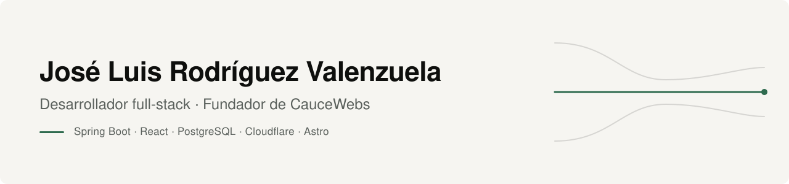
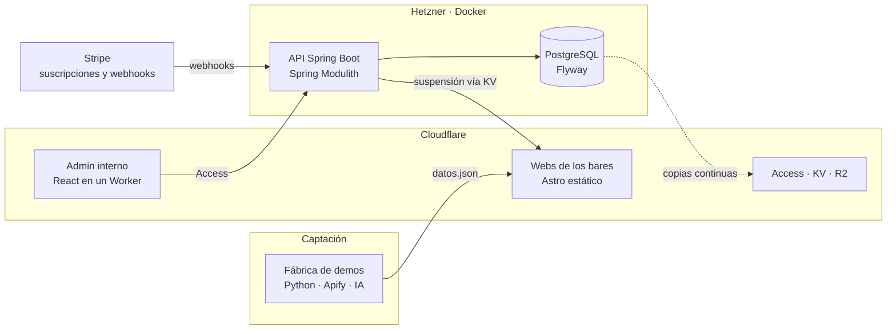
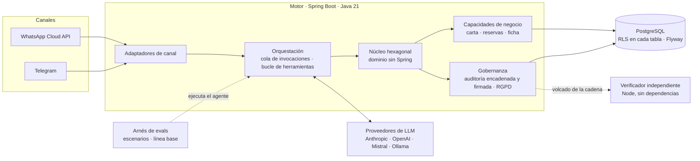

Desarrollador full-stack. Construyo productos completos: base de datos, API, panel, despliegue y cobro real.
De día trabajo como desarrollador full-stack en una empresa de telecomunicaciones.
Por mi cuenta he fundado Cauce, que diseño, programo y opero yo solo.

---

## Cauce - https://cauce.dev

Software para negocios locales, en dos ramas: **CauceWebs**, un SaaS en producción con clientes y facturación real, y **Cauce OS**, un motor de agentes de IA.

### CauceWebs · en producción

**Webs para bares de Andalucía, hechas una a una y mantenidas por suscripción.** Cada web es única: la estructura sale de un sistema de piezas y la paleta, de las fotos del propio local.
Detrás hay una plataforma completa que lleva desde el primer contacto con el bar hasta la factura.

| | |
|---|---|
| **Plataforma interna** | Spring Boot 4 (Java 25) + React + PostgreSQL en Hetzner con Docker. Una sola API dividida en módulos con fronteras que vigilan los tests. |
| **Cobros** | Stripe en real: suscripciones, webhooks idempotentes, facturas y rectificativas. |
| **Webs** | Astro en Cloudflare. Sistema de piezas y pieles: la paleta se extrae de las fotos y se ajusta para pasar contraste AA. |
| **Fábrica de demos** | Python: fotos de Google Maps con Apify, clasificación con IA y verificación de la carta antes de enseñar nada al bar. |
| **Módulos** | CRM con buscador de leads, suspensión y retirada por impago, vigilancia de las webs, cambios con cupo, incidencias, guiones de venta, rol comercial con comisiones y la parte fiscal (calendario, modelos 303 y 130). |
| **Entrega** | CI/CD con GitHub Actions: tests, imagen, despliegue y vuelta atrás automática si la API no arranca sana. |
| **Diseño** | Cada pantalla pasa por un laboratorio propio: variantes, auditoría de accesibilidad y entrega a React. |

**A octubre de 2026:** 900+ tests de API · 580+ tests del admin · 41 migraciones Flyway · 80 decisiones técnicas documentadas.

Arquitectura, capturas y decisiones en **[cauce-showcase](https://github.com/JoseLuisPayoyo/cauce-showcase)**. El código es privado.

### Cauce OS · motor de agentes de IA

**Plataforma para construir agentes de IA, escrita en Java, con código público (licencia BUSL).** Un agente atiende a las personas por sus canales de mensajería, usa las herramientas del negocio que se le conceden y deja cada paso en un registro que se puede verificar sin fiarse del propio motor.
Multi-tenant desde la primera migración: el aislamiento entre negocios lo pone la base de datos, no el código.

| | |
|---|---|
| **Motor** | Spring Boot 3.5 (Java 21) en 16 módulos Gradle. Núcleo hexagonal: el dominio no importa Spring, y canales y proveedores de LLM son puertos con adaptadores intercambiables. |
| **Multi-tenant con RLS** | La aplicación se conecta con un rol sin privilegios que no puede saltarse Row-Level Security. Las 25 tablas tienen políticas, y sin contexto de tenant no se ve nada. Las operaciones entre tenants usan salidas acotadas, una por caso, y la autorización es la misma relación de visibilidad. |
| **Auditoría verificable** | Registro que solo se añade, encadenado por hash y firmado con Ed25519 con una clave que la base de datos no contiene. Un verificador independiente, de un solo fichero y sin código de Cauce, lo comprueba contra una especificación publicada; su autotest corre en CI. |
| **Evals con línea base medida** | Escenarios escritos como datos, cada uno repetido 5 veces, con los bloqueantes exigidos al 100 %. Cada ejecución guarda commit, huella del prompt, tokens y coste, y se compara con la anterior. |
| **Bucle agéntico acotado** | Tope de rondas por mensaje entrante que cuenta los reintentos, ventana de contexto que no separa una llamada de su resultado, herramientas concedidas por agente y respuesta de respaldo si algo falla. |
| **Un solo reloj** | Toda fecha que se compara después sale del reloj de la base de datos, no de la JVM. Salió de un test intermitente por la deriva entre los dos relojes. |

**A octubre de 2026:** 1.278 tests · 45 migraciones Flyway · 9 ADR · 40 escenarios de evaluación · línea base del 98 % (147 de 150 repeticiones en comprobaciones deterministas).

Código en **[cauceos/cauce](https://github.com/cauceos/cauce)** · [cauce.dev](https://cauce.dev)

---

## Experiencia

**Desarrollador full-stack** · Empresa de telecomunicaciones

**Fundador y desarrollador** · Cauce
CauceWebs: producto, arquitectura, desarrollo, infraestructura, cobros y venta, de la idea a clientes que pagan.
Cauce OS: diseño y desarrollo del motor de agentes, con su modelo multi-tenant, su auditoría y su arnés de evaluación.

**Formación** · Técnico Superior en Desarrollo de Aplicaciones Multiplataforma (DAM)

---

## Stack

**Backend** · Java, Spring Boot, Spring Modulith, PostgreSQL (RLS), Flyway, Testcontainers, Gradle, Python
**Frontend** · React, TypeScript, Vite, Tailwind, shadcn/ui, Astro
**Infraestructura** · Docker, Hetzner, Cloudflare (Workers, KV, R2, Access), GitHub Actions
**IA e integraciones** · Anthropic, APIs compatibles con OpenAI, Ollama, WhatsApp Cloud API, Telegram, Stripe, Apify, n8n

---

## Contacto

[joseluisrv.dev@gmail.com](mailto:joseluisrv.dev@gmail.com) · [LinkedIn](https://www.linkedin.com/in/joseluispayoyo/) · [caucewebs.es](https://caucewebs.es) · [cauce.dev](https://cauce.dev)
