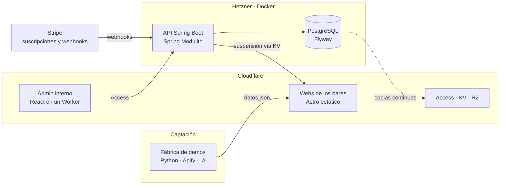

Desarrollador full-stack. Construyo productos completos: base de datos, API, panel, despliegue y cobro real.
De día trabajo en una empresa de telecomunicaciones con agentes de voz con IA, WhatsApp Business API y automatización con n8n.
Por mi cuenta he fundado [CauceWebs](https://caucewebs.es), un SaaS en producción que diseño, programo y opero yo solo.

---

## CauceWebs

**Webs para bares de Andalucía, hechas una a una y mantenidas por suscripción.** Cada web es única: la estructura sale de un sistema de piezas y la paleta, de las fotos del propio local.
Detrás hay una plataforma completa que lleva desde el primer contacto con el bar hasta la factura.

| | |
|---|---|
| **Plataforma interna** | Spring Boot 4 (Java 25) + React + PostgreSQL en Hetzner con Docker. Una sola API dividida en módulos con fronteras que vigilan los tests. |
| **Cobros** | Stripe en real: suscripciones, webhooks idempotentes, facturas y rectificativas. |
| **Webs** | Astro en Cloudflare. Sistema de piezas y pieles: la paleta se extrae de las fotos y se ajusta para pasar contraste AA. |
| **Fábrica de demos** | Python: fotos de Google Maps con Apify, clasificación con IA y verificación de la carta antes de enseñar nada al bar. |
| **Módulos** | CRM con buscador de leads, suspensión y retirada por impago, vigilancia de las webs, cambios con cupo, incidencias, guiones de venta, rol comercial con comisiones y la parte fiscal (calendario, modelos 303 y 130). |
| **Entrega** | CI/CD con GitHub Actions: tests, imagen, despliegue y vuelta atrás automática si la API no arranca sana. |
| **Diseño** | Cada pantalla pasa por un laboratorio propio: variantes, auditoría de accesibilidad y entrega a React. |

**En cifras:** 900+ tests de API · 580+ tests del admin · 41 migraciones Flyway · 80 decisiones técnicas documentadas.

Arquitectura, capturas y decisiones en **[cauce-showcase](https://github.com/JoseLuisPayoyo/cauce-showcase)**. El código es privado.

---

## Cauce OS

Plataforma open source para construir agentes de IA, escrita en Java.
[cauceos/cauce](https://github.com/cauceos/cauce) · [cauce.dev](https://cauce.dev)

---

## Experiencia

**Desarrollador full-stack** · Empresa de telecomunicaciones
Agentes de voz con IA, integraciones con WhatsApp Business API y flujos de automatización con n8n.

**Fundador y desarrollador** · [CauceWebs](https://caucewebs.es)
Producto, arquitectura, desarrollo, infraestructura, cobros y venta. De la idea a clientes que pagan.

**Formación** · Técnico Superior en Desarrollo de Aplicaciones Multiplataforma (DAM)

---

## Stack

**Backend** · Java, Spring Boot, Spring Modulith, PostgreSQL, Flyway, Testcontainers, Python
**Frontend** · React, TypeScript, Vite, Tailwind, shadcn/ui, Astro
**Infraestructura** · Docker, Hetzner, Cloudflare (Workers, KV, R2, Access), GitHub Actions
**Integraciones** · Stripe, Apify, APIs de IA, WhatsApp Business API, n8n

---

## Contacto

[joseluisrv.dev@gmail.com](mailto:joseluisrv.dev@gmail.com) · [LinkedIn](https://www.linkedin.com/in/joseluispayoyo/) · [caucewebs.es](https://caucewebs.es)
